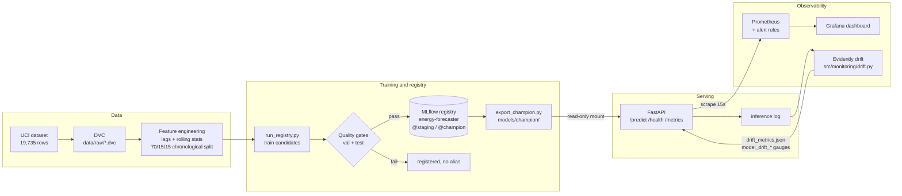

# AI-Based Smart Energy Monitoring Assistant

[](https://github.com/SwayamGoyal11/Smart_Energy_Monitoring_Assistant/actions/workflows/ci.yml)
[](https://github.com/SwayamGoyal11/Smart_Energy_Monitoring_Assistant/actions/workflows/cd.yml)

An end-to-end MLOps system that forecasts household appliance energy use (Wh) for the next 10-minute interval, trained on the [UCI Appliances Energy Prediction](https://archive.ics.uci.edu/dataset/374/appliances+energy+prediction) dataset.

It covers the full lifecycle: DVC-versioned data, leak-free time-series features, MLflow experiment tracking and a quality-gated model registry, a FastAPI inference service, Prometheus and Grafana observability, Evidently drift detection, and GitHub Actions CI/CD publishing the serving image to GHCR.

All project code lives in [`energy-monitoring-mlops/`](energy-monitoring-mlops/); commands below run from that directory unless noted.

---

## Architecture



| Layer | Tooling | Where |
|---|---|---|
| Data versioning | DVC (MD5-pinned raw CSV) | `data/raw/energydata_complete.csv.dvc` |
| Features | Calendar/cyclical time features, consumption lags 1-3, rolling mean/std on the shifted target | `src/features/feature_engineering.py` |
| Experiment tracking & registry | MLflow (SQLite `mlflow.db`), aliases `staging` / `champion` | `src/models/registry.py`, `run_registry.py` |
| Orchestration (optional) | ZenML pipeline over the same steps | `src/pipelines/`, [docs/zenml.md](energy-monitoring-mlops/docs/zenml.md) |
| Serving | FastAPI + Pydantic contract; features rebuilt server-side from raw readings | `src/api/`, `src/serving/schemas.py` |
| Observability | Prometheus metrics + alert rules, provisioned Grafana dashboard | `src/monitoring/metrics.py`, `prometheus/`, `grafana/` |
| Drift detection | Evidently (normed Wasserstein, alert at ≥ 0.1) on inputs and predictions | `src/monitoring/drift.py` |
| Delivery | Multi-stage Docker image, GitHub Actions CI/CD, GHCR | `Dockerfile`, `.github/workflows/` |

---

## Production champion: two-stage hurdle model

The serving model is **`energy-forecaster` version 1** (alias `@champion`), a two-stage hurdle model (`src/models/hurdle.py`) built for the target's heavy standby skew: the median interval is 60 Wh and about 79% of intervals sit at or below 100 Wh, with short bursts up to ~1,080 Wh.

1. **Stage 1, regime classifier:** standardized logistic regression predicts whether the interval is an active burst (`Appliances > 100 Wh`, ~22% of training intervals).
2. **Stage 2, load-intensity regressor:** a HistGradientBoosting regressor trained on active intervals only.
3. **Routing:** intervals with P(active) ≥ 0.5 use the Stage 2 forecast; standby intervals use persistence (y<sub>t</sub> = y<sub>t-1</sub>). Predictions are clipped at 0 Wh.

### Benchmarks

Chronological splits (train 13,810 / val 2,959 / test 2,960 rows); MAE and RMSE in Wh per 10-minute interval. Best value per column in bold.

| Model | Val MAE | Val RMSE | Val R² | Test MAE | Test RMSE | Test R² | Gates |
|---|---:|---:|---:|---:|---:|---:|:---:|
| **Two-stage hurdle (champion)** | **24.63** | **59.66** | **0.582** | **26.21** | 62.56 | 0.526 | pass |
| Linear Regression | 28.40 | 60.22 | 0.574 | 27.24 | **60.91** | **0.551** | pass |
| Persistence baseline | 26.15 | 66.44 | 0.481 | 26.75 | 66.85 | 0.459 | n/a |
| Random Forest | 33.43 | 65.07 | 0.503 | 45.24 | 76.85 | 0.285 | fail |
| XGBoost | 37.56 | 68.64 | 0.446 | 60.15 | 90.13 | 0.017 | fail |

The hurdle model cuts validation RMSE from 66.4 Wh (persistence) to 59.7 Wh, and is the only candidate that beats persistence on MAE on both held-out splits. Linear Regression keeps a slightly lower test RMSE. The champion is picked on validation RMSE only; test is a pass/fail gate, never a selection criterion.

The full evaluation, failure modes and limitations are in the **[model card](energy-monitoring-mlops/docs/model_card.md)**.

---

## Quality gates and model registry

`run_registry.py` trains each candidate, logs it to MLflow, and registers it as a new version of `energy-forecaster`. Before any alias is assigned, the candidate must pass `src/models/quality_gates.py` on **both** the validation and test splits:

| Gate | Threshold |
|---|---|
| RMSE | ≤ 65.0 Wh |
| MAE | ≤ 35.0 Wh |
| R² | ≥ 0.50 |
| RMSE vs. persistence baseline | must not exceed the baseline's RMSE on the same split |

- Passing candidates get `@staging`; the passing candidate with the lowest validation RMSE also gets `@champion`.
- Failing candidates are still registered (tagged `quality_gate=failed`) for audit, but receive no alias and are never served.
- The script exits non-zero if no candidate passes, which is what fails the CI quality-gate job.

---

## CI/CD

### CI ([`.github/workflows/ci.yml`](.github/workflows/ci.yml))

Runs on every push to `main`, every `v*.*.*` tag push, and every pull request.

| Job | What it checks |
|---|---|
| Lint & code quality | `ruff check` with the rules in `ruff.toml` (pyflakes + syntax/statement errors) |
| PyTest suite | All 241 tests (data, features, hurdle, input validation, model quality, registry, API, monitoring, deployment config), with coverage |
| Docker build verification | Builds the image with the `type=gha` layer cache, imports the app inside it, asserts it runs as uid 10001 |
| Quality gate check | Runs `run_registry.py` against a throwaway MLflow store; fails if no candidate passes the gates |

The dataset is not pulled from the DVC remote in CI. The [`fetch-dataset`](.github/actions/fetch-dataset/action.yml) action downloads the public UCI archive and verifies it against the MD5 in the `.dvc` pointer, so CI tests the exact bytes DVC tracks.

### CD ([`.github/workflows/cd.yml`](.github/workflows/cd.yml))

Triggered only by a **successful** CI run that came from a push to `main` or a `v*.*.*` tag; pull-request runs never publish. It checks out the exact commit CI tested and pushes `ghcr.io/swayamgoyal11/energy-forecaster-api`:

| Source | Tags published |
|---|---|
| Push to `main` | `:latest`, `:sha-<short>` |
| Tag `v1.2.3` | `:1.2.3`, `:1.2`, `:sha-<short>` (never `:latest`) |

To cut a release:

```bash
git tag v1.0.0
git push origin v1.0.0     # CI runs on the tag; CD publishes only if it is green
```

---

## Local development

### Prerequisites

- Python 3.12
- [uv](https://docs.astral.sh/uv/) (or plain `pip`)
- Docker Desktop (or Docker Engine with the Compose plugin)
- Git

### 1. Install

PowerShell:

```powershell
git clone https://github.com/SwayamGoyal11/Smart_Energy_Monitoring_Assistant.git
cd Smart_Energy_Monitoring_Assistant\energy-monitoring-mlops
uv venv --python 3.12 venv
.\venv\Scripts\Activate.ps1
uv pip install -r requirements.txt
```

bash:

```bash
git clone https://github.com/SwayamGoyal11/Smart_Energy_Monitoring_Assistant.git
cd Smart_Energy_Monitoring_Assistant/energy-monitoring-mlops
uv venv --python 3.12 venv
source venv/bin/activate
uv pip install -r requirements.txt
```

`requirements.txt` is the full development environment; `requirements-serve.txt` is the slim runtime the Docker image installs.

### 2. Get the dataset

**With DVC** (on a machine that has the configured remote, `../dvc_storage_remote`):

```bash
python -m dvc pull
```

**Without the DVC remote**, download the public copy and check it matches the DVC pointer (MD5 `69ef922b5fcafcd49097cfc09e07167e`):

PowerShell:

```powershell
Invoke-WebRequest -Uri "https://archive.ics.uci.edu/static/public/374/appliances+energy+prediction.zip" -OutFile "$env:TEMP\energydata.zip"
Expand-Archive -Path "$env:TEMP\energydata.zip" -DestinationPath data\raw -Force
(Get-FileHash data\raw\energydata_complete.csv -Algorithm MD5).Hash   # 69EF922B5FCAFCD49097CFC09E07167E
```

bash:

```bash
curl -fsSL -o /tmp/energydata.zip "https://archive.ics.uci.edu/static/public/374/appliances+energy+prediction.zip"
unzip -o -j /tmp/energydata.zip energydata_complete.csv -d data/raw
md5sum data/raw/energydata_complete.csv                            # 69ef922b5fcafcd49097cfc09e07167e
```

### 3. Train, gate and export

```bash
python run_pipeline.py            # Phase 1 benchmarks; writes data/processed/features.csv
python run_registry.py            # train hurdle + linear_regression, apply gates, register
python scripts/export_champion.py # @champion -> models/champion/ (what the container serves)
```

`python run_registry.py --models hurdle linear_regression random_forest xgboost` trains every candidate. Browse runs and the registry with:

```bash
python -m mlflow ui --backend-store-uri sqlite:///mlflow.db --port 5000   # http://localhost:5000
```

### 4. Run the tests

```bash
python -m pytest tests -q          # 241 tests, ~3 minutes
python -m ruff check .             # same lint gate as CI (install with: uv pip install ruff)
```

Tests that touch the registry or API build throwaway MLflow stores under pytest's `tmp_path`; they never read or write the project's `mlflow.db`.

---

## Running the API

The image does not bake in a model. It serves the MLflow model directory mounted at `/app/models/champion`, so export one first (step 3 above); a new champion ships without a rebuild.

### Full stack: API + Prometheus + Grafana (Docker Compose)

PowerShell:

```powershell
$env:GRAFANA_ADMIN_PASSWORD = "change-me"
docker compose up --build -d
docker compose ps                  # api should report "healthy"
```

bash:

```bash
GRAFANA_ADMIN_PASSWORD=change-me docker compose up --build -d
docker compose ps
```

| Service | URL | Notes |
|---|---|---|
| API | http://localhost:8000/docs | OpenAPI UI; `/metrics` serves Prometheus metrics on the same port |
| Prometheus | http://localhost:9090 | `/targets` should show the `energy-api` job UP; rules under `/alerts` |
| Grafana | http://localhost:3000 | user `admin`, password from `GRAFANA_ADMIN_PASSWORD` (`admin` if unset) |

Compose mounts `./models/champion` and `./reports/evidence` read-only into the API and keeps the inference log, Prometheus TSDB and Grafana state in named volumes. To promote a new champion: `python run_registry.py`, `python scripts/export_champion.py`, then `docker compose restart api`.

### Standalone container from GHCR

bash:

```bash
docker pull ghcr.io/swayamgoyal11/energy-forecaster-api:latest
docker run -d --name energy-api -p 8000:8000 \
  -v "${PWD}/models/champion:/app/models/champion:ro" \
  ghcr.io/swayamgoyal11/energy-forecaster-api:latest
```

PowerShell:

```powershell
docker pull ghcr.io/swayamgoyal11/energy-forecaster-api:latest
docker run -d --name energy-api -p 8000:8000 `
  -v "${PWD}\models\champion:/app/models/champion:ro" `
  ghcr.io/swayamgoyal11/energy-forecaster-api:latest
```

Pin `:sha-<short>` or a release tag such as `:1.0.0` instead of `:latest` for reproducible deploys. If the package is private, run `docker login ghcr.io` first with a personal access token that has `read:packages`.

### Endpoints

| Method | Path | Purpose |
|---|---|---|
| GET | `/health` | Liveness and model status; 503 when no model is loaded (drives the container `HEALTHCHECK`) |
| POST | `/predict` | Forecast one interval |
| POST | `/predict/batch` | Forecast up to 1,000 intervals: `{"instances": [<request>, ...]}` |
| GET | `/model-info` | Registry version, model type and quality-gate metrics of the served model |
| GET | `/metrics` | Prometheus exposition |

Clients send raw readings, not engineered features: the target timestamp, the last 6 or more appliance readings (oldest first), and the current sensor values. Save this as `payload.json`:

```json
{
  "target_timestamp": "2016-05-20T18:00:00",
  "recent_appliances_wh": [60, 50, 50, 60, 230, 180],
  "lights": 0, "T1": 22.5, "RH_1": 40.2, "T2": 21.1, "RH_2": 37.8,
  "T3": 23.0, "RH_3": 38.1, "T6": 14.6, "RH_6": 48.0, "T_out": 13.8,
  "Press_mm_hg": 756.0, "RH_out": 71.0, "Windspeed": 3.5,
  "Visibility": 40.0, "Tdewpoint": 8.6
}
```

bash:

```bash
curl -s http://localhost:8000/health
curl -s -X POST http://localhost:8000/predict -H "Content-Type: application/json" -d @payload.json
```

PowerShell (in Windows PowerShell `curl` is an alias for `Invoke-WebRequest`, so use `Invoke-RestMethod` or `curl.exe`):

```powershell
Invoke-RestMethod http://localhost:8000/health
Invoke-RestMethod -Method Post -Uri http://localhost:8000/predict -ContentType "application/json" -InFile payload.json
```

Response:

```json
{"target_timestamp": "2016-05-20T18:00:00", "predicted_appliances_wh": 180.0, "model_name": "energy-forecaster", "model_version": "1"}
```

Out-of-range sensor values, non-finite numbers, unknown fields and short histories are rejected with 422.

---

## Monitoring and drift

### Metrics and dashboard

`GET /metrics` exports:

| Metric | Meaning |
|---|---|
| `http_requests_total` | Requests by method, route and status code |
| `http_request_duration_seconds` | Latency histogram by method and route |
| `model_prediction_value` | Distribution of predicted Wh |
| `model_stage_predictions_total`, `model_active_stage_ratio` | Hurdle routing: standby vs. active-burst decisions |
| `model_drift_score`, `model_drift_share`, `model_drift_detected` | Latest Evidently report, per column and overall |

Grafana provisions the **Energy Forecaster - Serving & Drift** dashboard automatically: service health, `/predict` latency p50/p95/p99, 5xx ratio, prediction quantiles, hurdle active-stage ratio and per-column drift scores. Prometheus evaluates `prometheus/alerts.yml`: API down, 5xx ratio > 5%, `/predict` p95 > 250 ms, drift detected, and active-stage ratio > 50% for 30 minutes (training baseline ~22%).

### Drift reports (Evidently)

Drift compares a current window of model inputs and predictions against the training split. Calendar features are excluded, since production data always comes from a later date than training. Generate `data/processed/features.csv` first with `python run_pipeline.py`.

```bash
# Baseline: the held-out test split stands in for production traffic
python -m src.monitoring.drift

# Real traffic: copy the API's inference log out of the compose volume
mkdir -p data/monitoring           # PowerShell: New-Item -ItemType Directory -Force data\monitoring
docker cp energy-api:/app/data/monitoring/inference_log.csv data/monitoring/inference_log.csv
python -m src.monitoring.drift --current data/monitoring/inference_log.csv

# Options: --method {wasserstein,ks}  --threshold <float>  --fail-on-drift (exit 2 on any alert)
```

Outputs:

- `reports/evidence/drift_report.html`: the interactive Evidently report; open it in a browser.
- `reports/evidence/drift_metrics.json`: structured scores. The API re-reads this file on the next scrape after it changes, so the `model_drift_*` gauges and Grafana panels update without a restart.

---

## Repository layout

```text
.github/
├── workflows/ci.yml                  # lint, tests, Docker build, quality gates
├── workflows/cd.yml                  # GHCR publish after green CI on main / v*.*.*
└── actions/fetch-dataset/            # UCI download + MD5 check against the DVC pointer
energy-monitoring-mlops/
├── data/raw/energydata_complete.csv.dvc
├── src/
│   ├── data/                         # loading and dataset validation
│   ├── features/                     # leak-free lags, rolling stats, chronological split
│   ├── models/                       # trainers, hurdle model, quality gates, registry
│   ├── pipelines/                    # ZenML pipeline
│   ├── validation/                   # physical-bounds input validation
│   ├── serving/, api/                # Pydantic contract, FastAPI app, model loader
│   └── monitoring/                   # Prometheus metrics, inference log, Evidently drift
├── tests/                            # 241 PyTest tests
├── scripts/export_champion.py        # registry alias -> models/champion/
├── run_pipeline.py                   # Phase 1 benchmark pipeline
├── run_registry.py                   # train, gate, register
├── Dockerfile, docker-compose.yml    # serving image and monitoring stack
├── prometheus/, grafana/             # scrape config, alerts, provisioned dashboard
├── notebooks/01_eda.ipynb            # EDA: distributions, diurnal cycles, ACF/PACF
├── reports/evidence/                 # dataset validation, model comparison, drift outputs
└── docs/                             # model card, deployment runbook, ZenML guide
```

---

## Documentation

- [Model card](energy-monitoring-mlops/docs/model_card.md): split protocol, benchmarks, hurdle design, failure modes, release gates.
- [Deployment runbook](energy-monitoring-mlops/docs/deployment.md): image design, compose stack, alerts.
- [ZenML pipeline](energy-monitoring-mlops/docs/zenml.md): optional orchestration setup.

---

## Project status

### Phase 1: Development and reproducibility (complete)

- [x] Dataset acquisition and validation (19,735 records)
- [x] EDA: diurnal cycles, ACF/PACF, sensor correlations (`notebooks/01_eda.ipynb`)
- [x] Leak-free feature engineering and strict chronological 70/15/15 split
- [x] Baselines: persistence, Linear Regression, Random Forest, XGBoost
- [x] DVC dataset versioning and MLflow experiment tracking
- [x] Model card with empirical gap analysis

### Phase 2: Productionization and deployment (complete)

- [x] PyTest suite: 241 tests across data, model quality, registry, API, monitoring and deployment config
- [x] Model-risk quality gates against fixed thresholds and the persistence baseline
- [x] Two-stage hurdle model promoted as champion (`energy-forecaster` v1)
- [x] MLflow Model Registry with `staging` / `champion` aliases
- [x] FastAPI inference service with Pydantic contract validation
- [x] Prometheus metrics, alert rules and Grafana dashboard
- [x] Evidently drift detection wired into the metrics endpoint
- [x] Multi-stage, non-root Docker image and Compose monitoring stack
- [x] GitHub Actions CI (lint, tests, image build, quality gates) and CD to GHCR
