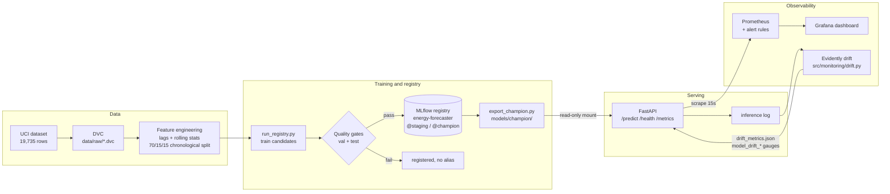
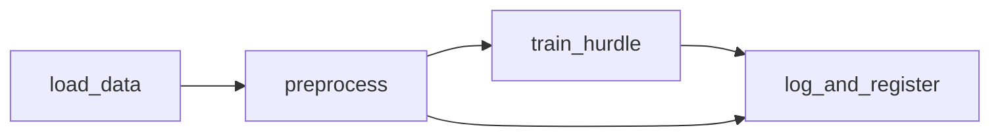

# AI-Based Smart Energy Monitoring Assistant

[](https://github.com/SwayamGoyal11/Smart_Energy_Monitoring_Assistant/actions/workflows/ci.yml)
[](https://github.com/SwayamGoyal11/Smart_Energy_Monitoring_Assistant/actions/workflows/cd.yml)

An end-to-end MLOps system that forecasts household appliance energy use (Wh) for the next 10-minute interval, trained on the [UCI Appliances Energy Prediction](https://archive.ics.uci.edu/dataset/374/appliances+energy+prediction) dataset.

It covers the full lifecycle: DVC-versioned data, leak-free time-series features, MLflow experiment tracking and a quality-gated model registry, a FastAPI inference service, Prometheus and Grafana observability, Evidently drift detection, and GitHub Actions CI/CD publishing the serving image to GHCR.

All project code lives in [`energy-monitoring-mlops/`](energy-monitoring-mlops/); commands below run from that directory unless noted.

## Project status

The project implementation is complete across data versioning, time-series feature engineering, model training and evaluation, MLflow tracking and registry, FastAPI serving, monitoring, and CI/CD deployment. The sections below describe the implemented architecture and the current serving model.

Seven empty commits were added to the Git history as progress checkpoints for these areas: dataset versioning, feature engineering, model training and evaluation, MLflow registry, API serving, monitoring and drift detection, and CI/CD deployment. They are history-only markers; the implementation they refer to is in the earlier project commits, and the checkpoint commits do not change the source tree.

---

## Phase 1-3 deliverables and evidence matrix

Release **v1.2.0**. Every artifact is linked from here; paths are relative to the repository root.

| # | Deliverable | Implementation | Evidence | Verify |
|---|---|---|---|---|
| 1 | DVC dataset versioning | [`.dvc` pointer](energy-monitoring-mlops/data/raw/energydata_complete.csv.dvc), [`.dvc/config`](energy-monitoring-mlops/.dvc/config), [`fetch-dataset` action](.github/actions/fetch-dataset/action.yml) | [`dataset_validation.json`](energy-monitoring-mlops/reports/evidence/dataset_validation.json) | `dvc pull`, or CI's MD5 check against the pointer |
| 2 | EDA and leak-free features | [`01_eda.ipynb`](energy-monitoring-mlops/notebooks/01_eda.ipynb), [`feature_engineering.py`](energy-monitoring-mlops/src/features/feature_engineering.py) | [Model card §2-3](energy-monitoring-mlops/docs/model_card.md#2-data) | `pytest tests/test_data.py` |
| 3 | Baselines and benchmarks | [`run_pipeline.py`](energy-monitoring-mlops/run_pipeline.py), [`hurdle.py`](energy-monitoring-mlops/src/models/hurdle.py) | [`model_comparison.csv`](energy-monitoring-mlops/reports/evidence/model_comparison.csv) (Phase 1 baselines), [model card §4](energy-monitoring-mlops/docs/model_card.md#4-quantitative-evaluation) | `python run_pipeline.py` |
| 4 | MLflow tracking and quality-gated registry | [`registry.py`](energy-monitoring-mlops/src/models/registry.py), [`quality_gates.py`](energy-monitoring-mlops/src/models/quality_gates.py), [`run_registry.py`](energy-monitoring-mlops/run_registry.py) | Registry audit (23 versions, `@champion` v5) in [`retraining_lifecycle.md`](energy-monitoring-mlops/reports/evidence/retraining_lifecycle.md#3-live-registry-audit); [`serving_metadata.json`](energy-monitoring-mlops/models/champion/serving_metadata.json) | `python -m mlflow ui --backend-store-uri sqlite:///mlflow.db` (local store, not committed) |
| 5 | ZenML pipeline runs | [`zenml_pipeline.py`](energy-monitoring-mlops/pipelines/zenml_pipeline.py), [`run_zenml.py`](energy-monitoring-mlops/run_zenml.py) | [ZenML wrapper guide](energy-monitoring-mlops/docs/zenml_wrapper.md) | [Running the ZenML pipeline](#running-the-zenml-pipeline-windows-powershell) |
| 6 | Automated test suite | [`tests/`](energy-monitoring-mlops/tests/) (289 tests: data, features, hurdle, validation, registry, API, monitoring, drift experiment, retraining flow, deployment config) | CI "PyTest suite" job | `python -m pytest` |
| 7 | Docker image and Compose stack | [`Dockerfile`](energy-monitoring-mlops/Dockerfile), [`docker-compose.yml`](energy-monitoring-mlops/docker-compose.yml), [`.dockerignore`](energy-monitoring-mlops/.dockerignore) | [Deployment runbook](energy-monitoring-mlops/docs/deployment.md), `tests/test_deployment.py` | `docker compose up --build -d` |
| 8 | GitHub Actions CI/CD to GHCR | [`ci.yml`](.github/workflows/ci.yml), [`cd.yml`](.github/workflows/cd.yml) | [Actions runs](https://github.com/SwayamGoyal11/Smart_Energy_Monitoring_Assistant/actions); image `ghcr.io/swayamgoyal11/energy-forecaster-api` | badges above; [CI/CD](#cicd) |
| 9 | Live API deployment | FastAPI [`app.py`](energy-monitoring-mlops/src/api/app.py); self-contained image with the baked champion bundle [`models/champion/`](energy-monitoring-mlops/models/champion/) | Render service, configured in the Render dashboard; no Render config file or service URL is committed ([runbook](energy-monitoring-mlops/docs/deployment.md#hosted-deployment-render)) | `GET /health` reports `model_version: "5"`; `python scripts/simulate_traffic.py --url <service url>` |
| 10 | Prometheus and Grafana observability | [`metrics.py`](energy-monitoring-mlops/src/monitoring/metrics.py), [`prometheus.yml`](energy-monitoring-mlops/prometheus/prometheus.yml), [`alerts.yml`](energy-monitoring-mlops/prometheus/alerts.yml), [dashboard JSON](energy-monitoring-mlops/grafana/provisioning/dashboards/json/energy-forecaster.json) | [Metrics and dashboard](#metrics-and-dashboard) | http://localhost:9090, http://localhost:3000 after `docker compose up` |
| 11 | Structured logging and traffic simulation | [`inference_log.py`](energy-monitoring-mlops/src/monitoring/inference_log.py) (JSON Lines), [`simulate_traffic.py`](energy-monitoring-mlops/scripts/simulate_traffic.py) | `tests/test_monitoring.py` | [Replay realistic traffic](#replay-realistic-traffic) |
| 12 | Deliberate drift experiment and Evidently reports | [`run_drift_experiment.py`](energy-monitoring-mlops/scripts/run_drift_experiment.py), [`drift.py`](energy-monitoring-mlops/src/monitoring/drift.py) | [`drift_report.html`](energy-monitoring-mlops/reports/evidence/drift_report.html), [`drift_metrics.json`](energy-monitoring-mlops/reports/evidence/drift_metrics.json), [`retraining_trigger_evidence.json`](energy-monitoring-mlops/reports/evidence/retraining_trigger_evidence.json) | `python scripts/run_drift_experiment.py` |
| 13 | Retraining lifecycle and champion promotion | [`verify_retraining_flow.py`](energy-monitoring-mlops/scripts/verify_retraining_flow.py), [`export_champion.py`](energy-monitoring-mlops/scripts/export_champion.py) | [`retraining_lifecycle.md`](energy-monitoring-mlops/reports/evidence/retraining_lifecycle.md) (25/25 checks) | `python scripts/verify_retraining_flow.py` |
| 14 | Model card, governance and limitations | [`model_card.md`](energy-monitoring-mlops/docs/model_card.md) | intended use, guardrails, evaluation, retraining rule, rollback, limitations | n/a |

**Key results.**
- **Champion:** two-stage hurdle v5. Validation RMSE 59.66 / MAE 24.63 / R² 0.582; test RMSE 62.56 / MAE 26.21 / R² 0.526.
- **Persistence baseline:** test RMSE 66.85.
- **Heatwave drift experiment:** RMSE rises to 73.06 Wh (+16.8%) and breaks the 65 Wh gate, so retraining triggers. The unshifted baseline does not trigger it.

---

## Architecture



| Layer | Tooling | Where |
|---|---|---|
| Data versioning | DVC (MD5-pinned raw CSV) | `data/raw/energydata_complete.csv.dvc` |
| Features | Calendar/cyclical time features, consumption lags 1-3, rolling mean/std on the shifted target | `src/features/feature_engineering.py` |
| Experiment tracking & registry | MLflow (SQLite `mlflow.db`), aliases `staging` / `champion` | `src/models/registry.py`, `run_registry.py` |
| Orchestration (optional) | ZenML wrapper over the existing hurdle training and registry | `pipelines/zenml_pipeline.py`, `run_zenml.py`, [wrapper guide](energy-monitoring-mlops/docs/zenml_wrapper.md) |
| Serving | FastAPI + Pydantic contract; features rebuilt server-side from raw readings | `src/api/`, `src/serving/schemas.py` |
| Observability | Prometheus metrics + alert rules, provisioned Grafana dashboard | `src/monitoring/metrics.py`, `prometheus/`, `grafana/` |
| Drift detection | Evidently (normed Wasserstein, alert at ≥ 0.1) on inputs and predictions | `src/monitoring/drift.py` |
| Delivery | Multi-stage Docker image, GitHub Actions CI/CD, GHCR | `Dockerfile`, `.github/workflows/` |

---

## Production champion: two-stage hurdle model

The serving model is **`energy-forecaster` version 5** (alias `@champion`; `@staging` points at the latest gated candidate, currently v23), a two-stage hurdle model (`src/models/hurdle.py`) built for the target's heavy standby skew: the median interval is 60 Wh and about 79% of intervals sit at or below 100 Wh, with short bursts up to ~1,080 Wh.

1. **Stage 1, regime classifier:** standardized logistic regression predicts whether the interval is an active burst (`Appliances > 100 Wh`, ~22% of training intervals).
2. **Stage 2, load-intensity regressor:** a HistGradientBoosting regressor trained on active intervals only.
3. **Routing:** intervals with P(active) ≥ 0.5 use the Stage 2 forecast; standby intervals use persistence (y<sub>t</sub> = y<sub>t-1</sub>). Predictions are clipped at 0 Wh.

### Benchmarks

Chronological splits (train 13,810 / val 2,959 / test 2,960 rows); MAE and RMSE in Wh per 10-minute interval. Best value per column in bold.

| Model | Val MAE | Val RMSE | Val R² | Test MAE | Test RMSE | Test R² | Gates |
|---|---:|---:|---:|---:|---:|---:|:---:|
| **Two-stage hurdle (champion)** | **24.63** | **59.66** | **0.582** | **26.21** | 62.56 | 0.526 | pass |
| Linear Regression | 28.40 | 60.22 | 0.574 | 27.24 | **60.91** | **0.551** | pass |
| Persistence baseline | 26.15 | 66.44 | 0.481 | 26.75 | 66.85 | 0.459 | n/a |
| Random Forest | 33.43 | 65.07 | 0.503 | 45.24 | 76.85 | 0.285 | fail |
| XGBoost | 37.56 | 68.64 | 0.446 | 60.15 | 90.13 | 0.017 | fail |

The hurdle model cuts validation RMSE from 66.4 Wh (persistence) to 59.7 Wh, and is the only candidate that beats persistence on MAE on both held-out splits. Linear Regression keeps a slightly lower test RMSE. The champion is picked on validation RMSE only; test is a pass/fail gate, never a selection criterion.

The full evaluation, failure modes and limitations are in the **[model card](energy-monitoring-mlops/docs/model_card.md)**.

---

## Quality gates and model registry

`run_registry.py` trains each candidate, logs it to MLflow, and registers it as a new version of `energy-forecaster`. Before any alias is assigned, the candidate must pass `src/models/quality_gates.py` on **both** the validation and test splits:

| Gate | Threshold |
|---|---|
| RMSE | ≤ 65.0 Wh |
| MAE | ≤ 35.0 Wh |
| R² | ≥ 0.50 |
| RMSE vs. persistence baseline | must not exceed the baseline's RMSE on the same split |

- Passing candidates get `@staging`; the passing candidate with the lowest validation RMSE also gets `@champion`.
- Failing candidates are still registered (tagged `quality_gate=failed`) for audit, but receive no alias and are never served.
- The script exits non-zero if no candidate passes, which is what fails the CI quality-gate job.
- Each logged model records only its inference dependencies (`INFERENCE_REQUIREMENTS` in `src/models/registry.py`, kept equal to the ranges in `requirements-serve.txt` by a test), so loading it in the serving image raises no dependency-mismatch warnings.

---

## CI/CD

### CI ([`.github/workflows/ci.yml`](.github/workflows/ci.yml))

Runs on every push to `main`, every `v*.*.*` tag push, and every pull request.

| Job | What it checks |
|---|---|
| Lint & code quality | `ruff check` with the rules in `ruff.toml` (pyflakes + syntax/statement errors) |
| PyTest suite | All 289 tests (data, features, hurdle, input validation, model quality, registry, API, monitoring, drift experiment, retraining flow, deployment config), with coverage |
| Docker build verification | Builds the image with the `type=gha` layer cache, imports the app inside it, asserts it runs as uid 10001 |
| Quality gate check | Runs `run_registry.py` against a throwaway MLflow store; fails if no candidate passes the gates |

The dataset is not pulled from the DVC remote in CI. The [`fetch-dataset`](.github/actions/fetch-dataset/action.yml) action downloads the public UCI archive and verifies it against the MD5 in the `.dvc` pointer, so CI tests the exact bytes DVC tracks.

### CD ([`.github/workflows/cd.yml`](.github/workflows/cd.yml))

Triggered only by a **successful** CI run that came from a push to `main` or a `v*.*.*` tag; pull-request runs never publish. It checks out the exact commit CI tested and pushes `ghcr.io/swayamgoyal11/energy-forecaster-api`:

| Source | Tags published |
|---|---|
| Push to `main` | `:latest`, `:sha-<short>` |
| Tag `v1.2.3` | `:1.2.3`, `:1.2`, `:sha-<short>` (never `:latest`) |

To cut a release:

```bash
git tag v1.0.0
git push origin v1.0.0     # CI runs on the tag; CD publishes only if it is green
```

---

## Local development

Every command block below is labelled **PowerShell** (Windows PowerShell 5.1 or PowerShell 7) or **bash** (Linux/macOS, or Git Bash/WSL on Windows). Blocks labelled **PowerShell or bash** run unchanged in either shell. All commands after the install step assume you are in `energy-monitoring-mlops/` with the virtual environment activated.

### Prerequisites

- Python 3.12
- Docker Desktop (or Docker Engine with the Compose plugin)
- Git

[uv](https://docs.astral.sh/uv/) is optional; nothing below requires it on your `PATH`.

### 1. Install

**PowerShell**

```powershell
git clone https://github.com/SwayamGoyal11/Smart_Energy_Monitoring_Assistant.git
cd Smart_Energy_Monitoring_Assistant\energy-monitoring-mlops
python -m venv venv
Set-ExecutionPolicy -ExecutionPolicy RemoteSigned -Scope Process
.\venv\Scripts\Activate.ps1
python -m pip install --upgrade pip
pip install -r requirements.txt
pip install ruff
```

`Set-ExecutionPolicy ... -Scope Process` allows `Activate.ps1` to run in the current window only. Run it again in each new PowerShell window before activating. `python` must be Python 3.12. If several versions are installed, create the environment with the Windows launcher instead: `py -3.12 -m venv venv`.

**bash**

```bash
git clone https://github.com/SwayamGoyal11/Smart_Energy_Monitoring_Assistant.git
cd Smart_Energy_Monitoring_Assistant/energy-monitoring-mlops
python3 -m venv .venv
source .venv/bin/activate
pip install --upgrade pip
pip install -r requirements.txt
pip install ruff
```

`python3` must be Python 3.12 (otherwise use `python3.12 -m venv .venv`). `ruff` is installed separately because `requirements.txt` doesn't include it, and the lint command in step 4 needs it.

`requirements.txt` is the full development environment; `requirements-serve.txt` is the slim runtime the Docker image installs. For faster installs, `python -m pip install uv` and then `python -m uv pip install -r requirements.txt` gives the same result.

To reactivate the environment in a new terminal:

| Shell | Command (from `energy-monitoring-mlops/`) |
|---|---|
| PowerShell | `Set-ExecutionPolicy -ExecutionPolicy RemoteSigned -Scope Process; .\venv\Scripts\Activate.ps1` |
| bash | `source .venv/bin/activate` |

### 2. Get the dataset

**With DVC** (on a machine that has the configured remote, `../dvc_storage_remote`). **PowerShell or bash:**

```bash
python -m dvc pull
```

**Without the DVC remote**, download the public copy and check it matches the DVC pointer (MD5 `69ef922b5fcafcd49097cfc09e07167e`):

**PowerShell**

```powershell
Invoke-WebRequest -Uri "https://archive.ics.uci.edu/static/public/374/appliances+energy+prediction.zip" -OutFile "$env:TEMP\energydata.zip"
Expand-Archive -Path "$env:TEMP\energydata.zip" -DestinationPath data\raw -Force
(Get-FileHash data\raw\energydata_complete.csv -Algorithm MD5).Hash   # 69EF922B5FCAFCD49097CFC09E07167E
```

**bash**

```bash
curl -fsSL -o /tmp/energydata.zip "https://archive.ics.uci.edu/static/public/374/appliances+energy+prediction.zip"
unzip -o -j /tmp/energydata.zip energydata_complete.csv -d data/raw
md5sum data/raw/energydata_complete.csv                            # 69ef922b5fcafcd49097cfc09e07167e (macOS: md5)
```

### 3. Train, gate and export

**PowerShell or bash**

```bash
python run_pipeline.py
python run_registry.py
python scripts/export_champion.py
```

- `run_pipeline.py` runs the Phase 1 benchmarks and writes `data/processed/features.csv`.
- `run_registry.py` trains hurdle + linear_regression, applies the gates and registers them. Add `--models hurdle linear_regression random_forest xgboost` to train every candidate.
- `export_champion.py` copies `@champion` to `models/champion/`, which is what the container serves.

Browse runs and the registry at http://localhost:5000 with:

```bash
python -m mlflow ui --backend-store-uri sqlite:///mlflow.db --port 5000
```

### 4. Run the tests and lint

**PowerShell or bash**

```bash
python -m pytest tests -q
python -m ruff check .
```

`pytest` runs 289 tests in about 3 minutes; `ruff` applies the same lint gate as CI. Tests that touch the registry or API build throwaway MLflow stores under pytest's `tmp_path` and never read or write the project's `mlflow.db`.

---

## Running the ZenML pipeline (Windows PowerShell)

The optional [`run_zenml.py`](energy-monitoring-mlops/run_zenml.py) entry point wraps the existing data loading, feature engineering, two-stage Hurdle model, MLflow artifact logging, and quality-gated registry. Existing DVC stages, training entry points, `src/models/artifact_logging.py`, and `src/models/registry.py` remain unchanged.



| Step | What it does | Named output artifacts |
|---|---|---|
| `load_data` | Loads the DVC-materialized CSV and sorts timestamps | `raw_data` |
| `preprocess` | Builds existing features and chronological 70/15/15 splits | `train_df`, `val_df`, `test_df` |
| `train_hurdle` | Fits the Hurdle model; tracks training with `mlflow_tracker` | `hurdle_model`, `fit_seconds`, `training_run_id` |
| `log_and_register` | Calls the existing registry helper for evaluation, full artifact logging, version creation, and gated aliases | `registration_result` |

Outputs use `Annotated` names. The model crosses steps through a custom **skops materializer** using the registry's trust allowlist. Logging and registration stay together because the existing helper owns its MLflow run; that run is linked to the ZenML-tracked training run. Caching is disabled so each invocation reads current input and registers a fresh candidate.

### Set up the environment and stack

Run from `energy-monitoring-mlops/` after installing the project requirements and materializing the dataset as described above. Repeat the environment variables in each new PowerShell terminal. This checkout's completed runs use `.zen/wrapper-validation`; using another ZenML configuration directory selects a different store.

```powershell
.\venv\Scripts\python.exe -m pip install uv
$env:VIRTUAL_ENV = (Resolve-Path .\venv).Path
$env:Path = "$env:VIRTUAL_ENV\Scripts;$env:Path"
$env:ZENML_CONFIG_PATH = Join-Path $PWD '.zen/wrapper-validation'
$env:PYTHONIOENCODING = 'utf-8'
$env:MLFLOW_DISABLE_AGENT_HINT = '1'
uv pip install --python .\venv\Scripts\python.exe "zenml[server,mlflow]>=0.98.0,<1.0.0"
uv run --active --no-project zenml integration install mlflow --uv -y

# Initialize once on a fresh checkout, before registering the stack.
if (!(Test-Path .zen/config.yaml)) { uv run --active --no-project zenml init }

# Match the existing project's SQLite tracking URI exactly.
$env:MLFLOW_TRACKING_URI = (& .\venv\Scripts\python.exe -c 'from src.models.registry import tracking_uri; print(tracking_uri())').Trim()

# Register once; these names are already configured in this local checkout.
uv run --active --no-project zenml experiment-tracker register mlflow_tracker --flavor=mlflow "--tracking_uri=$env:MLFLOW_TRACKING_URI"
uv run --active --no-project zenml stack register energy_mlflow_stack -a default -o default -e mlflow_tracker --set
```

If the tracker and stack already exist, skip their registration and select the stack:

```powershell
uv run --active --no-project zenml stack set energy_mlflow_stack
uv run --active --no-project zenml stack describe energy_mlflow_stack
uv run --active --no-project zenml experiment-tracker describe mlflow_tracker
```

### Execute all four steps

```powershell
# If the raw CSV is absent and the configured DVC remote is available:
uv run --active --no-project dvc pull

uv run --active --no-project python run_zenml.py
# Optional: choose a different input CSV with the same schema.
# uv run --active --no-project python run_zenml.py --raw-data data/raw/energydata_complete.csv
```

Expect all four steps to finish with status **completed**. Quality-gate failures make the pipeline fail while retaining the registered candidate for audit. A passing candidate receives `staging`; `champion` changes only if validation RMSE improves on the existing champion. Training does not automatically export or redeploy the serving model.

### Open the Docker dashboard

Start Docker Desktop. For the existing dashboard container:

```powershell
docker start energy-zenml-dashboard
docker ps --filter name=energy-zenml-dashboard
Invoke-WebRequest http://localhost:8237/health -UseBasicParsing
```

Open **[http://localhost:8237](http://localhost:8237)**. Select project **default**, then **Pipelines → energy_hurdle_pipeline**, and open a completed run. The graph shows the four steps and their artifact nodes; click a step's outputs or an artifact to inspect its type, version, and lineage.

For a new Docker deployment, the ZenML CLI command is:

```powershell
$env:DOCKER_HOST = 'npipe:////./pipe/dockerDesktopLinuxEngine'
uv run --active --no-project zenml login --local --docker --port 8237
```

ZenML **0.98.0** generated `/service\service.json` inside the Linux container on this Windows checkout, so that command failed. The running dashboard uses the official `zenmldocker/zenml-server:0.98.0` image directly, with the existing database mounted at a Linux path. Follow the [verified Docker creation commands](energy-monitoring-mlops/docs/zenml_wrapper.md#verified-docker-dashboard-on-this-windows-checkout) if the container does not exist. Native `zenml up` is deprecated and native Windows daemon startup is unsupported. Artifact metadata and graph nodes are verified; file previews from their original Windows paths inside Linux remain unverified.

### Inspect MLflow and the verified run

In another terminal with the same environment setup:

```powershell
uv run --active --no-project mlflow ui --backend-store-uri "$env:MLFLOW_TRACKING_URI" --port 5000
```

Open **[http://localhost:5000](http://localhost:5000)**, select experiment `energy-consumption-prediction`, and inspect the training run and its linked registry run. Open registered model **energy-forecaster** to see versions, gate tags, and aliases.

The end-to-end run verified on **12 November 2026** completed all four steps, reloaded the skops artifact, and passed a prediction check:

| Item | Verified value |
|---|---|
| ZenML run | `energy_hurdle_pipeline-2026_11_12-13_04_00_016944` |
| ZenML run ID | `9c09347c-059b-4333-a195-14007109586b` |
| MLflow training run | `ea76fca985d2489595981974799aaf52` |
| MLflow registry run | `e0d8dcba62934afeb62b8e7cef5f7a06` |
| Candidate | Version **16**, gates passed, `staging`, validation RMSE **59.6986** |
| Champion | Version **5**, validation RMSE **59.6618**; retained because its score is better |

These IDs and local runs are specific to this checkout; a fresh clone generates its own. `.zen/`, local logs, `mlflow.db`, and its SQLite sidecar files are ignored by Git. Full details are in the [ZenML wrapper guide](energy-monitoring-mlops/docs/zenml_wrapper.md).

---

## Running the API

The image does not bake in a model. It serves the MLflow model directory mounted at `/app/models/champion`, so export one first (step 3 above); a new champion ships without a rebuild.

### Full stack: API + Prometheus + Grafana (Docker Compose)

**PowerShell**

```powershell
$env:GRAFANA_ADMIN_PASSWORD = "change-me"; docker compose up -d --build
docker compose ps
```

**bash**

```bash
GRAFANA_ADMIN_PASSWORD=change-me docker compose up -d --build
docker compose ps
```

Wait until `docker compose ps` shows the `energy-api` container as `healthy` (about 30 seconds).

| Service | URL | Notes |
|---|---|---|
| API | http://localhost:8000/docs | OpenAPI UI; `/metrics` serves Prometheus metrics on the same port |
| Prometheus | http://localhost:9090 | `/targets` should show the `energy-api` job UP; rules under `/alerts` |
| Grafana | http://localhost:3000 | user `admin`, password from `GRAFANA_ADMIN_PASSWORD` (`admin` if unset) |

Compose mounts `./models/champion` and `./reports/evidence` read-only into the API and keeps the inference log, Prometheus TSDB and Grafana state in named volumes. To promote a new champion: `python run_registry.py`, `python scripts/export_champion.py`, then `docker compose restart api`.

### Standalone container from GHCR

**PowerShell**

```powershell
docker pull ghcr.io/swayamgoyal11/energy-forecaster-api:latest
docker run -d --name energy-api -p 8000:8000 -v "${PWD}\models\champion:/app/models/champion:ro" ghcr.io/swayamgoyal11/energy-forecaster-api:latest
```

**bash**

```bash
docker pull ghcr.io/swayamgoyal11/energy-forecaster-api:latest
docker run -d --name energy-api -p 8000:8000 -v "${PWD}/models/champion:/app/models/champion:ro" ghcr.io/swayamgoyal11/energy-forecaster-api:latest
```

Stop the compose stack first (`docker compose down`), since both use port 8000 and the container name `energy-api`. Pin `:sha-<short>` or a release tag such as `:1.0.0` instead of `:latest` for reproducible deploys. If the package is private, run `docker login ghcr.io` first with a personal access token that has `read:packages`.

### Endpoints

| Method | Path | Purpose |
|---|---|---|
| GET | `/health` | Liveness and model status; 503 when no model is loaded (drives the container `HEALTHCHECK`) |
| POST | `/predict` | Forecast one interval |
| POST | `/predict/batch` | Forecast up to 1,000 intervals: `{"instances": [<request>, ...]}` |
| GET | `/model-info` | Registry version, model type and quality-gate metrics of the served model |
| GET | `/metrics` | Prometheus exposition |

Clients send raw readings, not engineered features:

- `target_timestamp`: the start of the 10-minute interval to forecast.
- `recent_appliances_wh`: the last 6 or more appliance readings, oldest first.
- `lights` plus the 14 sensor values the model uses.

The request schema rejects unknown fields, so the raw dataset's unused sensors (`T4`, `RH_4`, `T5`, `RH_5`, `T7`-`T9`, `RH_7`-`RH_9`) must be left out.

### Single Prediction Example (API Contract)

One valid `/predict` request. Every field shown is required, and any other field is rejected.

**PowerShell** (`Invoke-RestMethod`; in Windows PowerShell 5.1 `curl` is an alias for `Invoke-WebRequest` and rejects curl's flags)

```powershell
$payload = @{
  target_timestamp = "2026-10-27T21:30:00"
  lights = 10.0
  T1 = 19.89; RH_1 = 47.596; T2 = 19.2; RH_2 = 44.79; T3 = 19.79; RH_3 = 44.4
  T6 = 7.026; RH_6 = 84.256; T_out = 6.6; Press_mm_hg = 733.5; RH_out = 92.0
  Windspeed = 7.0; Visibility = 63.0; Tdewpoint = 5.3
  recent_appliances_wh = @(60.0, 50.0, 50.0, 60.0, 60.0, 50.0)
} | ConvertTo-Json
Invoke-RestMethod -Uri "http://localhost:8000/predict" -Method Post -Body $payload -ContentType "application/json"
```

**bash**

```bash
curl -s -X POST http://localhost:8000/predict -H "Content-Type: application/json" -d '{
  "target_timestamp": "2026-10-27T21:30:00",
  "lights": 10.0,
  "T1": 19.89, "RH_1": 47.596, "T2": 19.2, "RH_2": 44.79, "T3": 19.79, "RH_3": 44.4,
  "T6": 7.026, "RH_6": 84.256, "T_out": 6.6, "Press_mm_hg": 733.5, "RH_out": 92.0,
  "Windspeed": 7.0, "Visibility": 63.0, "Tdewpoint": 5.3,
  "recent_appliances_wh": [60.0, 50.0, 50.0, 60.0, 60.0, 50.0]
}'
```

Response:

```json
{"target_timestamp": "2026-10-27T21:30:00", "predicted_appliances_wh": 50.0, "model_name": "energy-forecaster", "model_version": "5"}
```

To use real cURL from Windows PowerShell, call `curl.exe` explicitly and send the body from a file. Windows PowerShell 5.1 strips the inner double quotes from inline JSON arguments, and the API then returns `JSON decode error`. Quote `"@payload.json"`, because a bare `@` is PowerShell's splatting operator.

```powershell
$payload | Out-File -Encoding ascii payload.json
curl.exe -s -X POST http://localhost:8000/predict -H "Content-Type: application/json" --data "@payload.json"
```

Out-of-range sensor values, non-finite numbers, unknown fields, missing fields and short histories are rejected with 422.

---

## Monitoring and drift

### Metrics and dashboard

`GET /metrics` exports:

| Metric | Meaning |
|---|---|
| `http_requests_total` | Requests by method, route and status code |
| `http_request_duration_seconds` | Latency histogram by method and route |
| `model_prediction_value` | Distribution of predicted Wh |
| `model_stage_predictions_total`, `model_active_stage_ratio` | Hurdle routing: standby vs. active-burst decisions |
| `model_input_validation_failures_total` | Rejected requests by route and stage (`schema`: malformed body or out-of-range field; `domain`: derived feature frame breaks the model input contract) |
| `model_drift_score`, `model_drift_share`, `model_drift_detected` | Latest Evidently report, per column and overall |

Grafana provisions the **Energy Forecaster - Serving & Drift** dashboard automatically: service health, `/predict` latency p50/p95/p99, 5xx ratio, prediction quantiles, hurdle active-stage ratio and per-column drift scores. Prometheus evaluates `prometheus/alerts.yml`: API down, 5xx ratio > 5%, `/predict` p95 > 250 ms, drift detected, input-validation rejections above 10% of `/predict` traffic, and active-stage ratio > 50% for 30 minutes (training baseline ~22%).

Every served prediction is also appended to `INFERENCE_LOG_PATH` as structured JSON Lines, one object per predicted row: `{"event": "inference", "logged_at", "target_timestamp", "model_version", <model features...>, "prediction"}`. The drift command reads this file directly (older CSV logs still load).

### Traffic warmup

A fresh stack has served no predictions, so most panels show "No data". Right after `docker compose up`, run these two steps (**PowerShell or bash**, with the environment activated):

**Step 1: replay realistic data through the API.** This sends 250 real dataset rows to `/predict` and saves what it sent to `data/monitoring/simulated_traffic.jsonl`.

```bash
python scripts/simulate_traffic.py
```

**Step 2: compute and publish Evidently drift metrics for that traffic.**

```bash
python -m src.monitoring.drift --current data/monitoring/simulated_traffic.jsonl
```

Step 2 needs `--current`. Without it, the drift command scores the held-out test split instead of the replayed traffic, and that report flags drift (20 of 21 features, see [Drift reports](#drift-reports-evidently)). The API reads the new `drift_metrics.json` on its next scrape, so the drift panels show the replay's result: no drift alerts for the default train-split replay.

Then open the dashboard at http://localhost:3000/d/energy-forecaster?from=now-5m&to=now&refresh=5s. That link sets the time range to **Last 5 minutes** and auto-refresh to **5s**; you can also set both from the time picker and refresh menu at the top right. By default the dashboard shows the last 6 hours and refreshes every 30s, which makes a short burst of traffic hard to see. Prometheus scrapes every 15 seconds, so new requests appear within about 15-30 seconds.

Script options and what each split's replay shows are under [Replay realistic traffic](#replay-realistic-traffic).

### Drift reports (Evidently)

Drift compares a current window of model inputs and predictions against the training split. Calendar features are excluded, since production data always comes from a later date than training. Generate `data/processed/features.csv` first with `python run_pipeline.py`.

To use the held-out test split as a stand-in for production traffic (**PowerShell or bash**):

```bash
python -m src.monitoring.drift
```

To score real traffic, copy the API's inference log out of the compose volume first. The log needs at least 200 served predictions; with fewer, the command prints `Drift check skipped: current has N rows` and exits with code 1. On a fresh stack, the [traffic warmup](#traffic-warmup) gives drift a realistic window without copying this log.

**PowerShell**

```powershell
New-Item -ItemType Directory -Force data\monitoring | Out-Null
docker cp energy-api:/app/data/monitoring/inference_log.jsonl data\monitoring\inference_log.jsonl
python -m src.monitoring.drift --current data/monitoring/inference_log.jsonl
```

**bash**

```bash
mkdir -p data/monitoring
docker cp energy-api:/app/data/monitoring/inference_log.jsonl data/monitoring/inference_log.jsonl
python -m src.monitoring.drift --current data/monitoring/inference_log.jsonl
```

Options: `--method wasserstein|ks`, `--threshold <float>`, and `--fail-on-drift`, which exits with code 2 when any alert fires.

Outputs:

- `reports/evidence/drift_report.html`: the interactive Evidently report; open it in a browser.
- `reports/evidence/drift_metrics.json`: structured scores. The API re-reads this file on the next scrape after it changes, so the `model_drift_*` gauges and Grafana panels update without a restart. Whichever report you generate last is what Grafana and the `EnergyModelDriftDetected` alert reflect.

The default test-split report flags drift (20 of 21 features), because the test window comes later in the season than the training data.

### Deliberate drift experiment

`scripts/run_drift_experiment.py` builds a controlled production scenario and records whether it should trigger retraining:

- Summer heatwave: +8 °C on `T1`, `T2`, `T3`, `T6`, `T_out`.
- Humidity sensor bias: -18% on `RH_1`, `RH_2`, `RH_3`, `RH_6`, `RH_out`.
- Heavier evening bursts: appliance load ×1.5 + 50 Wh from 17:00 to 22:59.

The shifts are applied to the raw series and features are rebuilt, so lags and ground truth stay consistent. The drifted batch has the same timestamps as the test split, so the unshifted test split is a like-for-like baseline. Retraining triggers only when dataset drift is detected **and** performance breaches: a release quality gate fails, or RMSE rises at least 10% over the baseline.

```bash
python scripts/run_drift_experiment.py            # --dry-run to print without writing
```

| Champion v5 | RMSE | MAE | R² | Drifted features | Retrain |
|---|---|---|---|---|---|
| Baseline (test split) | 62.56 | 26.21 | 0.526 | 20/21 (seasonal) | no |
| Heatwave scenario | 73.06 | 30.66 | 0.633 | 20/21, mean score 2.25 vs 0.95 | **yes** |

RMSE rises 16.8% and breaks the 65 Wh gate. R² goes up because the heavier evening load widens the target's variance; RMSE and MAE are the degradation measure here. The run writes `drift_report.html`, `drift_metrics.json` and `retraining_trigger_evidence.json` to `reports/evidence/`. A local compose stack mounts that folder, so Grafana and `EnergyModelDriftDetected` show this scenario until you regenerate `drift_metrics.json` (for example with the traffic replay below).

### Replay realistic traffic

`scripts/simulate_traffic.py` posts real dataset rows to `/predict/batch` in chronological batches that mix standby and active-burst intervals (rows above the hurdle model's 100 Wh boundary). Each row carries the row's own timestamp and sensor readings plus the six actual readings before it, exactly as a client would send them. It writes what it sent to `data/monitoring/simulated_traffic.jsonl` in the inference-log format, so drift scores just this replay, not everything the API has served.

**PowerShell or bash** (with the stack running):

```bash
python scripts/simulate_traffic.py
python -m src.monitoring.drift --current data/monitoring/simulated_traffic.jsonl
```

Defaults are 250 rows (drift needs at least 200) sampled from the train split, sent in batches of 5 with the split's natural standby/active mix. Options:

- `--url <base url>`: any deployment, local or remote, e.g. a Render service URL (default `$ENERGY_API_URL` or `http://localhost:8000`). The script waits up to `--wait` seconds (default 90) for `/health`, so a sleeping free-tier instance can cold-start, and retries timeouts, 429 and 5xx responses (`--retries`, `--timeout`).
- `--split train|val|test`, `--rows <n>`, `--seed <n>`, `--delay <seconds>`.
- `--batch-size <n>`: rows per `/predict/batch` call; `1` sends single `/predict` requests.
- `--active-share <0-1>`: force a share of active-burst rows instead of the natural mix. This skews the lag features, so it can trigger drift on its own.
- `--invalid-share <0-1>`: share of all requests that are deliberately malformed (out-of-range sensor, wrong type, short history, unknown field). They are sent as single `/predict` calls, rejected with 422, counted in `model_input_validation_failures_total` (the **Validation rejections** panel and the `EnergyApiInputValidationFailures` alert), and never logged. The alert needs rejections above 10% of `/predict*` requests for 10 minutes, so the run must last that long: `--rows 1000 --invalid-share 0.15 --delay 3` sends about 380 requests over roughly 19 minutes (each batch counts as one request, so the rejected share of requests is well above 15%).
- `--log <path>` / `--no-log`: where the JSON Lines traffic log goes, or skip it.

The script prints the standby/active mix, the 422 count and the MAE against the actual readings, and exits with code 2 if any valid batch failed or an invalid payload was not rejected.

Which split you replay decides what the dashboard shows, because drift is measured against the training split. Results with the default 250 rows and `--seed 42` (exact counts shift a little with the seed):

| `--split` | Features drifted | Alerts | Dashboard drift status |
|---|---|---|---|
| `train` | 1/21 | none | OK |
| `val` | 21/21 | dataset, prediction, target | drift detected |
| `test` | 20/21 | dataset, prediction | drift detected |

Replaying the train split shows the monitoring path working when traffic matches the training data; it says nothing about how the model does on newer data. The `val` and `test` results are the real seasonal shift the model card describes.

---

## Repository layout

```text
.github/
├── workflows/ci.yml                  # lint, tests, Docker build, quality gates
├── workflows/cd.yml                  # GHCR publish after green CI on main / v*.*.*
└── actions/fetch-dataset/            # UCI download + MD5 check against the DVC pointer
energy-monitoring-mlops/
├── data/raw/energydata_complete.csv.dvc
├── src/
│   ├── data/                         # loading and dataset validation
│   ├── features/                     # leak-free lags, rolling stats, chronological split
│   ├── models/                       # trainers, hurdle model, quality gates, registry
│   ├── pipelines/                    # ZenML pipeline
│   ├── validation/                   # physical-bounds input validation
│   ├── serving/, api/                # Pydantic contract, FastAPI app, model loader
│   └── monitoring/                   # Prometheus metrics, inference log, Evidently drift
├── tests/                            # 243 PyTest tests
├── scripts/export_champion.py        # registry alias -> models/champion/
├── scripts/simulate_traffic.py       # replay dataset rows through /predict for dashboards and drift
├── run_pipeline.py                   # Phase 1 benchmark pipeline
├── run_registry.py                   # train, gate, register
├── Dockerfile, docker-compose.yml    # serving image and monitoring stack
├── prometheus/, grafana/             # scrape config, alerts, provisioned dashboard
├── notebooks/01_eda.ipynb            # EDA: distributions, diurnal cycles, ACF/PACF
├── reports/evidence/                 # dataset validation, model comparison, drift outputs
└── docs/                             # model card, deployment runbook, ZenML guide
```

---

## Documentation

- [Model card](energy-monitoring-mlops/docs/model_card.md): intended and out-of-scope use, features and input guardrails, evaluation, release gates, monitoring and retraining governance, rollback, limitations.
- [Deployment runbook](energy-monitoring-mlops/docs/deployment.md): compose stack, GHCR CI/CD, hosted (Render) requirements, image design, alerts.
- [Retraining lifecycle evidence](energy-monitoring-mlops/reports/evidence/retraining_lifecycle.md): drift trigger, registry audit, promotion-policy replay, champion bundle verification.
- [ZenML Hurdle wrapper](energy-monitoring-mlops/docs/zenml_wrapper.md): four-step pipeline, Windows/uv setup, MLflow linking, and verified Docker dashboard commands.
- [Earlier ZenML pipeline](energy-monitoring-mlops/docs/zenml.md): original orchestration setup.

---

## Project status

### Phase 1: Development and reproducibility (complete)

- [x] Dataset acquisition and validation (19,735 records)
- [x] EDA: diurnal cycles, ACF/PACF, sensor correlations (`notebooks/01_eda.ipynb`)
- [x] Leak-free feature engineering and strict chronological 70/15/15 split
- [x] Baselines: persistence, Linear Regression, Random Forest, XGBoost
- [x] DVC dataset versioning and MLflow experiment tracking
- [x] Model card with empirical gap analysis

### Phase 2: Productionization and deployment (complete)

- [x] PyTest suite (243 tests at the end of Phase 2; 289 after Phase 3)
- [x] Model-risk quality gates against fixed thresholds and the persistence baseline
- [x] Two-stage hurdle model promoted as champion (`energy-forecaster` v5)
- [x] MLflow Model Registry with `staging` / `champion` aliases
- [x] FastAPI inference service with Pydantic contract validation
- [x] Prometheus metrics, alert rules and Grafana dashboard
- [x] Evidently drift detection wired into the metrics endpoint
- [x] Multi-stage, non-root Docker image and Compose monitoring stack
- [x] GitHub Actions CI (lint, tests, image build, quality gates) and CD to GHCR

### Phase 3: Monitoring, drift and governance (complete, v1.2.0)

- [x] Structured JSON Lines inference logging and an input-validation rejection counter on `/metrics`
- [x] Prometheus alerts and a Grafana panel for input-validation failures; config/metric alignment tests
- [x] Traffic simulator with mixed standby/burst batches, invalid payloads and remote-URL support
- [x] Deliberate heatwave drift experiment with Evidently reports and recorded retraining trigger evidence
- [x] Retraining lifecycle verification: registry audit, promotion-policy replay, champion bundle checks
- [x] Model card finalized as a governance and limitations report
